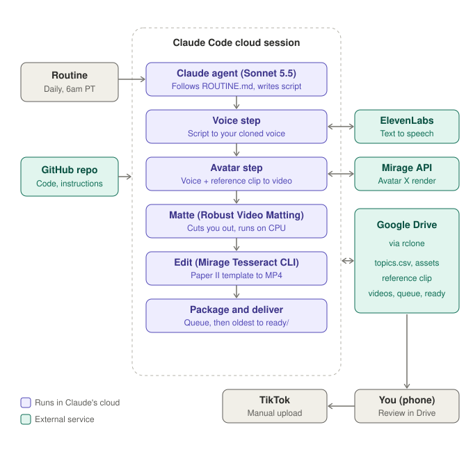

# Mirage TikTok pipeline

Makes one short TikTok video a day of an AI avatar of me recommending
[Aria Payments](https://ariapayments.biz/) to small-business owners, in the Paper II
collage style. A scheduled Claude Code cloud agent runs it; I review each finished video
on my phone and upload it to TikTok by hand.

## Architecture



Nothing persists between cloud sessions, so everything the pipeline remembers lives in
Google Drive. API keys and the Drive token are environment variables in the Claude cloud
environment, never in this repo.

## Where things are

| Path | What it is |
|---|---|
| `ROUTINE.md` | The daily instructions the cloud agent follows |
| `instructions/script_writer.md` | Persona, approved claims, disclosure, script and on-screen text rules |
| `pipeline/` | The pipeline: `plan`, `produce`, `deliver`, `status`, `fetch-assets` |
| `pipeline/paper2.py` | The Paper II edit template |
| `scripts/cloud_setup.sh` | Prepares a fresh cloud session (pinned, checksum-verified downloads) |
| `scripts/build_paper2_assets.py` | Rebuilds the sticker, photo, circle and paper library |
| `templates/topics.csv` | Starter topic list (the live list is `topics.csv` in Drive) |
| `brand/` | Brand settings, fonts, logo; `brand/paper2/CREDITS.csv` lists image sources |

## Running it by hand

```bash
python3 -m pipeline status
python3 -m pipeline plan            # pick the next topic; prints what needs a script
python3 -m pipeline produce <id>    # after writing script.json for that video
python3 -m pipeline deliver         # move the oldest finished video into ready/
```

Settings come from `.env` locally (see `.env.example`).
